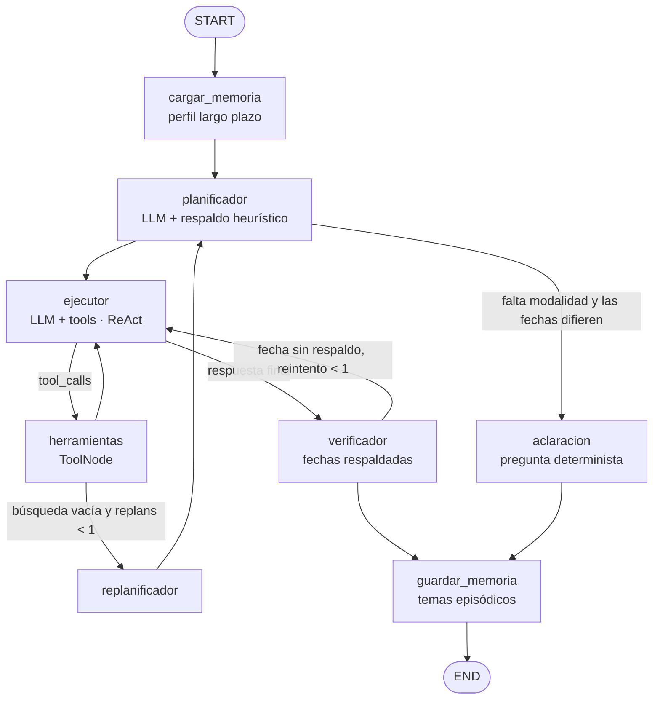

# Arquitectura y orquestación

## 1. Visión general

El agente es un **grafo de estados** construido con **LangGraph.js**. Cada nodo tiene una responsabilidad única y las
aristas condicionales implementan la planificación adaptativa. El LLM (OpenRouter, vía `@langchain/openai`) se usa
solo donde aporta razonamiento (planificar y ejecutar); todo lo que debe ser exacto (fechas, estados, verificación,
persistencia) es **código determinista**.

## 2. Componentes

| Capa | Archivo | Rol |
|---|---|---|
| Interfaz | `src/app.js` | CLI; `--traza` muestra la decisión de cada nodo (útil en la demo) |
| Orquestación | `src/agent/grafo.js` | Define nodos, aristas condicionales y el checkpointer |
| Estado | `src/agent/estado.js` | `messages`, `perfil`, `plan`, `replans`, `reintentos`, `feedback` |
| Planificación | `src/agent/planificador.js` | Heurística, parseo y validación del plan del LLM |
| Guardrail | `src/agent/verificador.js` | Detecta fechas no respaldadas por herramientas |
| Contexto | `src/agent/ventana.js` | Ventana por turnos (no rompe pares tool_call/tool_result) |
| Herramientas | `src/tools/index.js` | 4 tools con esquema `zod` |
| Conocimiento | `src/calendario.js`, `src/data/registros.js` | Calendarios oficiales 2026 + búsqueda por palabras clave |
| Recuperación semántica | `src/retrieval/` | Embeddings (OpenRouter), índice vectorial con caché y fusión híbrida (RRF) |
| Fechas | `src/lib/fechas.js` | Estado de plazos, "hoy" simulable, extracción de fechas |
| Memoria LP | `src/memory/perfilStore.js` | Perfil persistido en JSON |
| Prompt | `src/prompt.txt` | Rol, reglas y plantilla `{{HOY}} {{PERFIL}} {{PLAN}}` |

## 3. Memoria

| Tipo | Mecanismo | Alcance | Qué guarda |
|---|---|---|---|
| Corto plazo | `MemorySaver` (checkpointer LangGraph) por `thread_id` | La sesión del proceso | Historial de mensajes, último plan |
| Largo plazo | `PerfilStore` (JSON en `data/memoria/`) | Persiste entre ejecuciones | Modalidad, carrera, sede, jornada, nombre |
| Episódica | `registrarTema` | Persiste | Últimos 5 temas consultados |

El perfil se **inyecta en el prompt** en cada turno, de modo que el agente no vuelve a preguntar la modalidad.
La escritura del perfil solo ocurre cuando el estudiante declara el dato (herramienta `guardar_preferencias_estudiante`)
y `PerfilStore` filtra los campos permitidos (no se puede guardar contenido arbitrario).

## 4. Planificación adaptativa

1. **Plan inicial** (`planificador`): el LLM devuelve `{intencion, modalidad, actividad, pasos}`. Si falla o devuelve JSON
   inválido, se usa `planHeuristico`. La modalidad del perfil o del mensaje siempre prevalece sobre la del LLM.
2. **Adaptación 1 – aclaración**: si el plan es de calendario/agenda, no hay modalidad y las fechas de ambas modalidades
   difieren (`necesitaModalidad`), el grafo salta a `aclaracion` sin gastar tokens del ejecutor. Consultas como
   *feriado navidad* (misma fecha en ambas) **no** preguntan.
3. **Adaptación 2 – replanificación**: si `buscar_calendario_duoc` devuelve 0 resultados, `replanificador` vuelve al
   planificador (máx. 1 vez), que agrega el paso `reformular_busqueda` e instruye al ejecutor.
4. **Adaptación 3 – autocorrección**: si el verificador detecta una fecha sin respaldo, devuelve el control al ejecutor
   con retroalimentación (máx. 1 vez); si persiste, responde con un mensaje seguro de derivación.
5. **Seguimientos**: "¿y las online?" hereda la intención del turno previo (`intencionPrevia`).

## 5. Herramientas

| Tool | Capacidad | Descripción |
|---|---|---|
| `buscar_calendario_duoc` | Consulta | Busca actividades y devuelve inicio/término + **estado** (finalizada/en_curso/por_comenzar) y días restantes calculados por código |
| `proximos_hitos` | Consulta/razonamiento | Plazos que comienzan o vencen en los próximos N días |
| `guardar_preferencias_estudiante` | Memoria | Escribe el perfil de largo plazo |
| `generar_agenda_personal` | Escritura | Genera `agenda-<usuario>-<fecha>.md` o `.ics` con actividades vigentes |

## 6. Decisiones de diseño y trade-offs

- **LangGraph vs. bucle manual** (versión 1): el bucle `for` con `fetch` mezclaba orquestación, memoria y reglas.
  El grafo hace explícitos los estados y permite agregar nodos (p. ej. HITL) sin tocar los demás.
- **Aritmética de fechas en código, no en el LLM**: evita errores de cálculo ("faltan 13 días") y reduce tokens.
- **Verificador determinista**: una fecha equivocada es un error crítico; validar por regex es barato y auditable.
- **Recuperación híbrida (semántica + palabras clave)**: los embeddings encuentran sinónimos y lenguaje coloquial ("dejar un ramo" →
  retiro de asignaturas); las palabras clave aseguran coincidencias exactas (siglas como TAV). Se fusionan con RRF (k=60), se filtra por
  modalidad y se exige similitud mínima y cercanía al mejor resultado, para que una consulta fuera de ámbito devuelva lista vacía y
  active el replanificador. Como el catálogo es pequeño (~80 registros) basta un índice en memoria; el caché en disco se invalida
  por huella (modelo + texto). Las fechas siguen calculándose en código y validándose por el verificador: el LLM nunca "recuerda" una fecha.
  Degradación: sin API key, sin red o con `SEMANTIC_SEARCH=off` se usa solo palabras clave.
- **Planificador con respaldo heurístico**: el agente sigue funcionando si el LLM planificador falla.
- **Ventana por turnos**: recortar por número de mensajes puede dejar un `tool` huérfano y la API del LLM lo rechaza.

## 7. Seguridad

- Claves solo en `.env` (ignorado por git); `.env.example` como plantilla.
- Prompt con reglas anti-inyección y derivación de casos individuales.
- `PerfilStore` con lista blanca de campos; la herramienta de agenda escribe solo dentro de `SALIDAS_PATH`.
